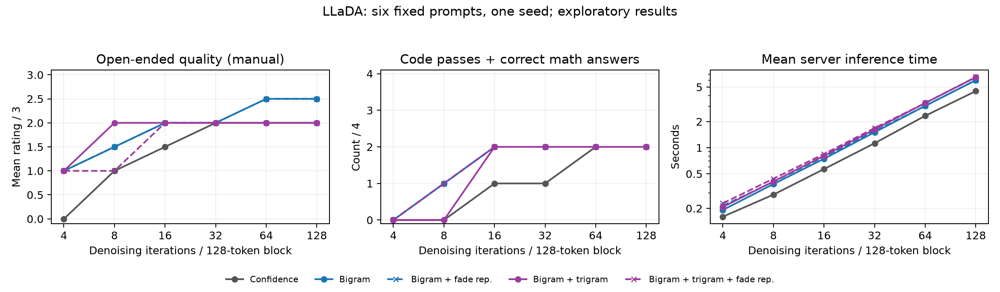

# LLaDA: bigram, trigram and fading repetition at low and high NFE

**22 October 2026 · 180 completed generations · six prompts · one fixed seed**

## Practical recommendation

**Use expanded PMI bigram with fading repetition OFF as the provisional general-purpose choice under these fixed settings.** It improved open-ended output over confidence-guided decoding at low budgets and recovered the train-speed answer earlier, without a measured coding-pass disadvantage. The added trigram term sometimes improved fluency, but did not consistently improve correctness enough to justify its extra cost. Fading repetition at strength one did not earn a default-on recommendation in this run.

This is a small exploratory comparison, not evidence of a universal optimum. There are only two prompts per task category and one seed. Small score differences should be treated as prompts for further testing.

| Regime | What I would use based on this sample |
| --- | --- |
| 4 iterations | None is reliable. Bigram produces a more recognizable opening than confidence guidance, but answers still loop and no coding/math task is solved. |
| 8 iterations | Bigram for mixed tasks. Trigram **without repetition penalty** is worth trying for open-ended text: it scored best there, but missed the train-speed answer that bigram got right. |
| 16–32 iterations | Bigram is the simpler default. Trigrams offer some fluency improvement, particularly at 32, with no extra fully passing coding task. |
| 64–128 iterations | Confidence guidance is faster and ties the coding/math answer counts. Bigram gives a better Amsterdam overview in this sample. Trigrams do not deliver a consistent correctness gain; fading repetition changes none of these outputs. |



Lines connect the six tested budgets as a visual guide. Overlapping lines often represent identical results. No confidence intervals are implied.

## Experiment

Model/Space: [Ruurd/llada-8b-instruct](https://huggingface.co/spaces/Ruurd/llada-8b-instruct), revision `b31a17ae5d4b017ffad71798ea5f35949416e4d2`.

Base model: `GSAI-ML/LLaDA-8B-Instruct`, pinned revision `08b83a6feb34df1a6011b80c3c00c7563e963b07`.

Five configurations were tested at **4, 8, 16, 32, 64 and 128 denoising iterations**, each with a **128-token output canvas and one 128-token block**:

1. **Confidence**: ordinary confidence-guided prediction/retention.
2. **BG**: expanded PMI bigram Viterbi.
3. **BG + R**: expanded PMI bigram Viterbi with probability-weighted repetition penalty and fading.
4. **BG + TG**: expanded PMI bigram + trigram Viterbi.
5. **BG + TG + R**: the same with repetition penalty and fading.

All n-gram conditions use the same expanded **877,064,287-token** corpus. The trigram comparison therefore holds corpus constant. Scorers are pinned to [Ruurd/llada-ngram-guidance-877m](https://huggingface.co/Ruurd/llada-ngram-guidance-877m), revision `5ad854a30691e137d78cac78a091f0834bd4ac8f`.

| Setting | Value |
| --- | --- |
| Top-k / candidates | 16 |
| Temperature | 0.7 |
| Bigram weight | 1 |
| Repetition strength | 1 |
| Repetition fading | ON for repetition conditions; existing absolute six-iteration logistic schedule |
| Count every candidate bigram occurrence | OFF |
| Repetition-risk alternative | OFF; default full-vocabulary probability-weighted expected-count mode |
| Bigram PMI minimum count / clipping | 1 / ±2 |
| Trigram minimum count / clipping | 2 / ±2 |
| Relative trigram weight / backoff strength | 0.5 / 50 |
| Open-ended EOS delay | Retention delay ON; bigram ending-delay strength 10 |
| Coding/math EOS delay | OFF; ending-delay strength 1 (neutral) |
| APD / revisable tokens | OFF / OFF |
| Sequence sampling | OFF, matching the interface default |
| Early stopping | OFF, to measure the requested full forward-pass budget |
| Generation seed | 42 for every run |

**Temperature interpretation:** ordinary confidence-guided generation samples using temperature 0.7 and top-k 16. Current deterministic MAP Viterbi uses raw diffusion log-probabilities and independently weighted PMI; its result is independent of temperature when sequence sampling is OFF. This study compares those existing decoding modes, rather than testing the sequence sampler.

**Fading interpretation:** effective repetition multipliers are approximately `1, 0.932, 0.697, 0.303, 0.068, 0, ...`. The fade is not stretched with the NFE budget. Consequently the four-step condition still has a nonzero penalty at its final step; at larger budgets the penalty is zero from step six onward.

### Small, fixed test set

| Category | Prompt/task | Reference |
| --- | --- | --- |
| Open | What do you know about Amsterdam? | Relevant, coherent overview with plausible Amsterdam facts |
| Open | Why is the sky blue? | Shorter-wavelength Rayleigh scattering; distinguish scattering from perception |
| Code | `sum_even(nums)`, including empty input | Sum all even integers; 11 fixed tests |
| Code | `balanced(s)` for (), [] and {}; ignore other characters | Proper nesting and matching; 16 fixed tests |
| Math | Solve `3(x − 2) + 4 = 2x + 9`, show brief steps | `x = 11` |
| Math | 120 km at 60 km/h, return 120 km at 40 km/h; average speed with brief explanation | `240 / (2 + 3) = 48 km/h` |

Open prompts are the first two from the existing standard question set. Code prompts request concise code only. All exact prompts and request parameters are saved in [manifest.json](manifest.json).

Runs rotated method order within task/budget groups. Budget order was 4, 128, 8, 64, 16, 32 so the high-budget reference would be covered early if quota ran out. Three one-step warmups were excluded from timings. **All 180 cases completed with zero errors and exactly their requested NFE: 7,560 timed diffusion forwards total.** No extra model or judge-model passes were used.

## Results

### Open-ended quality

These are **assistant manual-inspection ratings**, not independent human ratings or an automated judge-model score. Exact duplicate outputs share the same judgment. Quality uses a coarse 0–3 rubric: 0 unusable; 1 recognizable topic but major repetition/incoherence; 2 mostly usable with noticeable grammar, repetition or factual issues; 3 coherent, relevant and without a substantive issue found in this inspection. Fluency is also recorded separately so grammatical polish is not mistaken for factual correctness.

Each cell is the mean of **two answers**, so a half-point change can come from one answer moving one grade.

| Iterations | Confidence | BG | BG + R | BG + TG | BG + TG + R |
| ---: | ---: | ---: | ---: | ---: | ---: |
| 4 | 0.0 | 1.0 | 1.0 | 1.0 | 1.0 |
| 8 | 1.0 | 1.5 | 1.5 | 2.0 | 1.0 |
| 16 | 1.5 | 2.0 | 2.0 | 2.0 | 2.0 |
| 32 | 2.0 | 2.0 | 2.0 | 2.0 | 2.0 |
| 64 | 2.0 | 2.5 | 2.5 | 2.0 | 2.0 |
| 128 | 2.0 | 2.5 | 2.5 | 2.0 | 2.0 |

N-grams help the low-budget output become recognizable prose, but four-step generations remain heavily repetitive. At eight steps, the trigram sky answer is substantially more readable than bigram's long “wavelengths” loop. This is a useful individual win, rather than a general winner across tasks.

Trigram fluency reaches 3/3 on both open prompts at 32 and 64 iterations, whereas bigram averages 2.5. Its overall quality remains 2/3 because polished text still includes unsupported landmarks or inaccurate explanations. At 128, all methods are fluent; content errors distinguish them.

### Coding correctness

Each cell counts functions passing **every fixed test, out of two tasks**. Syntactically invalid code fails. Fenced code is extracted without repairing it; generated functions are executed in restricted subprocesses with time/CPU limits. Partial test passes are saved but do not count as solving the task.

| Iterations | Confidence | BG | BG + R | BG + TG | BG + TG + R |
| ---: | ---: | ---: | ---: | ---: | ---: |
| 4 | 0/2 | 0/2 | 0/2 | 0/2 | 0/2 |
| 8 | 0/2 | 0/2 | 0/2 | 0/2 | 0/2 |
| 16 | 1/2 | 1/2 | 1/2 | 1/2 | 1/2 |
| 32 | 1/2 | 1/2 | 1/2 | 1/2 | 1/2 |
| 64 | 1/2 | 1/2 | 1/2 | 1/2 | 1/2 |
| 128 | 1/2 | 1/2 | 1/2 | 1/2 | 1/2 |

Every method solves `sum_even` from 16 iterations onward. **No method solves bracket matching at any tested budget.** Longer-budget bracket functions are valid Python but omit bracket types, fail to pop the stack, or compare an opening bracket directly with a closing bracket. This is a semantic failure that local n-gram guidance does not repair.

There is **no fully passing coding-task advantage** for bigrams, trigrams or fading repetition in this sample. This conclusion concerns these two custom tasks and this seed, not a coding benchmark generally.

### Math correctness

Each cell counts **correct final answers out of two problems**. A separate stricter judgment checks the requested explanation.

| Iterations | Confidence | BG | BG + R | BG + TG | BG + TG + R |
| ---: | ---: | ---: | ---: | ---: | ---: |
| 4 | 0/2 | 0/2 | 0/2 | 0/2 | 0/2 |
| 8 | 0/2 | 1/2 | 1/2 | 0/2 | 1/2 |
| 16 | 0/2 | 1/2 | 1/2 | 1/2 | 1/2 |
| 32 | 0/2 | 1/2 | 1/2 | 1/2 | 1/2 |
| 64 | 1/2 | 1/2 | 1/2 | 1/2 | 1/2 |
| 128 | 1/2 | 1/2 | 1/2 | 1/2 | 1/2 |

Bigram recovers **48 km/h** at eight steps; confidence guidance gets it at 64. Trigrams alone miss it at eight steps, while adding fading repetition flips that answer from 40 to 48. At 32 steps, all four n-gram conditions give a correct worked train-speed solution. At 64 and 128 they instead give only a short correct answer, omitting the requested explanation. At 16, one trigram explanation says “22 hours + 3 hours = 5 hours” despite ending at 48 km/h; this counts as final-answer correct, not worked-solution correct.

**None of the 30 configurations gives the correct algebra solution, x = 11.** Even at 128 iterations all five confidently answer x = 7. Better grammar should therefore not be read as improved mathematical reasoning.

### What fading repetition actually changed

Across 72 matched pairs (two n-gram types × six tasks × six budgets), repetition:

- Left **53/72 outputs exactly identical**.
- Improved the recorded task-quality grade in **one** pair, tied in **67**, and worsened it in **four**.
- Changed **no final output at 32, 64 or 128 iterations**: 36/36 pairs were identical there.
- Added no fully passing coding task.

The one grade improvement was the eight-step trigram train-speed answer. The four deteriorations were the two four-step trigram math outputs and the two eight-step trigram open-ended outputs. Bigram's penalty changed some wording/diversity without changing any coarse quality grade.

Under **strength one and the existing six-step fade**, repetition therefore looks unnecessary as a general default. This does not establish what a different penalty strength, risk formulation or fade schedule would do.

### Latency

Mean server inference time in seconds, over the six prompts per cell. This includes model inference, decoding and streamed bookkeeping; it excludes client/network queue time and the initial warmups/downloads. Each case was timed once, so small differences are timing noise rather than a stable speed claim.

| Iterations | Confidence | BG | BG + R | BG + TG | BG + TG + R |
| ---: | ---: | ---: | ---: | ---: | ---: |
| 4 | 0.160 | 0.192 | 0.215 | 0.207 | 0.229 |
| 8 | 0.288 | 0.381 | 0.405 | 0.408 | 0.440 |
| 16 | 0.568 | 0.746 | 0.786 | 0.808 | 0.848 |
| 32 | 1.126 | 1.507 | 1.546 | 1.624 | 1.684 |
| 64 | 2.333 | 3.035 | 3.032 | 3.272 | 3.273 |
| 128 | 4.491 | 5.995 | 6.002 | 6.475 | 6.529 |

Bigram adds approximately **20–34%** over confidence guidance at the same NFE in this run. Adding trigrams to bigram adds roughly **7–8%**. All methods use the same number of diffusion-model forwards; the overhead is sequence scoring/selection and associated bookkeeping.

## Representative examples across all budgets

Full text for every configuration is in [outputs.md](outputs.md). These excerpts illustrate both benefits and failures; they were selected after reviewing the outputs.

### 4 iterations: recognizable prose still loops

Confidence, Amsterdam:

> Amsterdam is a capital of of the,, the,, the,, and, and, and and..

Bigram, Amsterdam:

> Amsterdam is the capital of the Netherlands. It is known for its beautiful architecture, picturesque canals, museums,, museums,, museums,, museums, and museums

The opening improves, but the remainder keeps looping. Adding trigrams or the strength-one penalty does not make these answers usable.

### 8 iterations: a trigram fluency win, but repetition can reverse it

Bigram, sky:

> The shorter wavelengths wavelengths wavelengths wavelengths wavelengths wavelengths wavelengths

Trigram, sky:

> The sky appears blue due to a phenomenon called Rayleigh scattering. This scattering occurs when sunlight enters the Earth's atmosphere and interacts with the tiny molecules of gases in the air.

The trigram answer later has malformed violet/vision sentences, so it is not perfect. With fading repetition, the sky answer instead develops an “orange, orange, orange” loop. Separately, repetition improves trigram's train-speed final answer from 40 to 48 km/h.

### 16 iterations: valid code can still be wrong

Trigram's bracket checker includes:

```python
for char in s:
    if char in '([{':
        stack.append(char)
    elif char in ')}':
        if not stack:
            return False
return True
```

It omits `]`, never removes matched opening brackets, and accepts unmatched openings. It passes 10/16 individual checks but fails the task. All methods do pass the simpler even-sum function at this budget.

### 32 iterations: a concrete math benefit

Confidence, train-speed answer:

> The average speed = speed entire trip is total

All four n-gram conditions instead give the correct derivation, ending:

> Total time = 2 hours + 3 hours = 5 hours.
>
> Average speed = Total distance / Total time = 240 km / 5 hours = 48 km/h.

### 64 iterations: fluent explanations can still contain physical errors

Confidence's sky answer includes:

> blue light is scattered much more easily than violet light

That is incorrect: shorter-wavelength violet scatters more strongly; perception helps explain why the sky looks blue. See [NASA's explanation](https://science.nasa.gov/ems/03_behaviors/). Trigram's answer is fluent but adds an unhelpful greater-atmospheric-thickness-during-day explanation, so neither receives full content credit. Fading penalties produce exactly the same outputs as the corresponding unpenalized modes at this budget.

### 128 iterations: longer context statistics do not guarantee relevant facts

Amsterdam landmark lists differ:

- Confidence: “the Red Square, Anne Frank House, and the Anne Frank Museum”.
- Bigram: “the Anne Frank House, the Royal Palace, and the Van Gogh Museum”.
- Trigram: “the Anne Frank House, the Queen's House, and the Vondelpark”.

Red Square is a Moscow landmark ([UNESCO](https://whc.unesco.org/en/list/545/)); the well-known Queen's House is in Greenwich ([Royal Museums Greenwich](https://www.rmg.co.uk/queens-house)). Trigrams can trade one locally plausible landmark combination for another without grounding it in Amsterdam. Bigram gives the better list here.

## Diversity diagnostic

Distinct-1 uses **unique LLaDA token IDs divided by total token IDs across each entire visible answer**. Visible text is retokenized with the pinned LLaDA tokenizer; EOS/padding are excluded by the interface. Raw unique-token counts and lengths are in [scores.csv](scores.csv). No distinct-2 metric is used.

Mean open-ended distinct-1:

| Iterations | Confidence | BG | BG + R | BG + TG | BG + TG + R |
| ---: | ---: | ---: | ---: | ---: | ---: |
| 4 | .190 | .261 | .256 | .302 | .313 |
| 8 | .664 | .375 | .504 | .474 | .538 |
| 16 | .505 | .502 | .587 | .516 | .528 |
| 32 | .528 | .563 | .563 | .591 | .591 |
| 64 | .562 | .550 | .550 | .571 | .571 |
| 128 | .587 | .579 | .579 | .587 | .587 |

This is a diagnostic, not the selection criterion. Confidence's high eight-step value is partly caused by its very short malformed Amsterdam answer. The penalty can increase diversity without improving grammar, facts or problem solving.

## Limits and reproducibility

- These six prompts and one seed are too small for statistical claims or a global optimum. The study selects among five method packages while holding the requested hyperparameters fixed; it does not optimize temperature, weights or penalty strength.
- Open-ended comparisons include the existing **ending-delay behavior**: baseline delays EOS retention, while Viterbi additionally applies the fading ending-logit penalty of ten. Their open-ended difference cannot be attributed solely to PMI. Coding/math disable both ending controls.
- Standard diffusion samples; Viterbi is deterministic with sequence sampling OFF. A future sampler comparison would answer a different question.
- A 128-token canvas is a maximum. EOS can yield shorter visible answers, especially in coding/math. Early stopping is OFF, so all runs still spend their full stated NFE.
- Judgments concern final outputs; intermediate denoising previews were not graded.
- Open ratings are subjective assistant inspection with spot-checked facts, not comprehensive fact verification. The coded tests cover fixed edge cases and do not prove general program correctness.
- Aggregate results should not hide that every algebra attempt and every bracket-checker task fails, even when the output looks polished.

Reproduce or resume generation with:

```bash
.venv/bin/python scripts/evaluate_llada_ngram_settings.py
.venv/bin/python scripts/check_llada_study_code.py
# Manual judgments are saved in manual_reviews.json.
.venv/bin/python scripts/summarize_llada_ngram_settings.py
```

The runner checks the pinned Space revision and saves each successful case immediately. The summarizer requires all 180 unique cases, verifies every request setting and NFE count, and checks review/output hashes.

Artifacts: [manifest](manifest.json), [all outputs](outputs.md), [raw generations](results.jsonl), [manual reviews](manual_reviews.json), [code tests](code_checks.json), [per-answer scores](scores.csv), [summary](summary.json), and [vector figure](comparison.svg).
