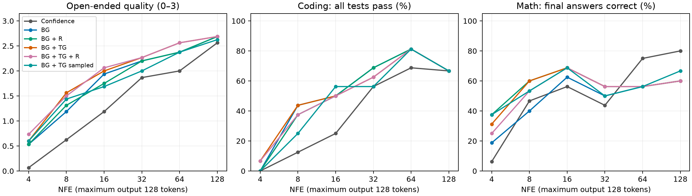
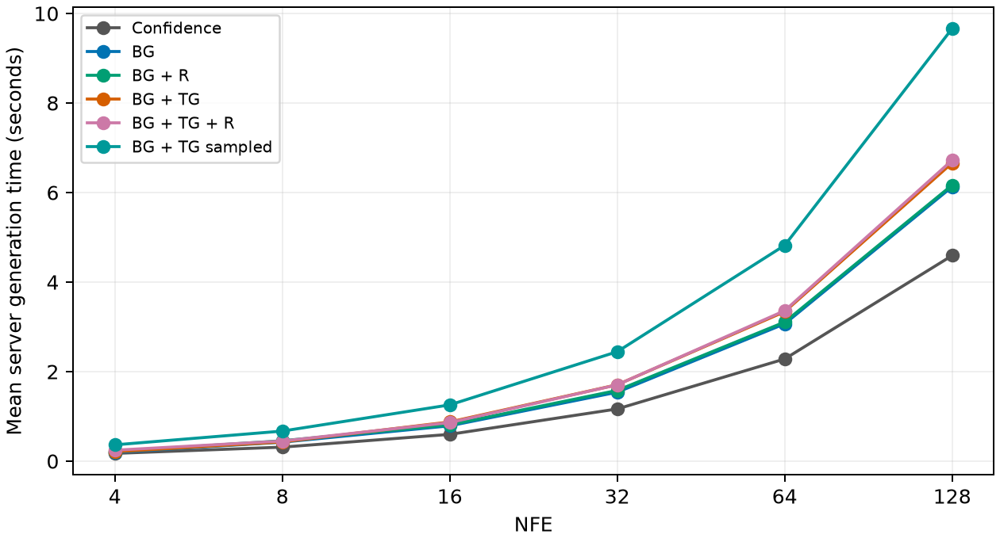

# LLaDA decoding study — six matched configurations

**1,692 graded outputs: 282 matched prompt/NFE cases × six configurations.** The original stopped study contributes 1,410 outputs; the user-requested sampled bigram + trigram configuration adds 282. Three original outputs from one incomplete comparison remain excluded. Every method uses precisely the same cases.

## Added configuration

**BG + TG sampled** uses Sample bigram-guided sequences ON, temperature **0.7**, and **no repetition penalty**. All other request settings, prompts, seeds, NFE budgets and the Space revision match the deterministic BG + TG counterpart. This samples from the existing joint diffusion-plus-n-gram sequence distribution; it is not independent token sampling or random perturbation of logits. One excluded warm-up request used the same sampled decoding path.

This replaces the earlier cancelled plan for a 720-run selected follow-up. The new 282-run arm was chosen by the user after viewing the main results, so the comparison is exploratory. The earlier 1,800-run main study was not resumed.

## Findings

- The highest observed pooled open-ended quality belongs to **BG + TG + R**; coding pass rate to **BG, BG + TG**; math final-answer accuracy to **BG + R**.
- Sampling changes open quality by **-0.160/3**, coding successes by **-4/94**, and math successes by **+0/94**, relative to deterministic BG + TG.
- Sampled sequence decoding has **+45.3%** measured pooled server latency relative to deterministic BG + TG. These runs were performed later, so hardware/service variation may contribute.
- Use the NFE tables and paired intervals below to assess the trade-offs. Pooled rankings alone can hide opposite low- and high-budget effects, especially in math.

For this fixed-seed study, **deterministic BG + TG remains the stronger default**: sampling has lower observed open-ended quality, four fewer coding successes and the same number of correct final math answers, with higher measured inference time. Math answers with valid working also fall from 32/94 to 27/94. This does not measure whether sampling is preferable when answer variety is the objective, nor its performance over multiple seeds.

## Overall metrics

| Method | Open quality /3 | Open fluency /3 | Coding solved | Math final correct | Math correct + valid working |
| --- | --- | --- | --- | --- | --- |
| Confidence | 1.394 | 1.457 | 36/94 (38.3%) | 48/94 (51.1%) | 30/94 |
| BG | 1.830 | 1.989 | 49/94 (52.1%) | 45/94 (47.9%) | 28/94 |
| BG + R | 1.819 | 1.968 | 48/94 (51.1%) | 53/94 (56.4%) | 30/94 |
| BG + TG | 1.957 | 2.149 | 49/94 (52.1%) | 52/94 (55.3%) | 32/94 |
| BG + TG + R | 1.979 | 2.170 | 48/94 (51.1%) | 50/94 (53.2%) | 31/94 |
| BG + TG sampled | 1.798 | 1.957 | 45/94 (47.9%) | 52/94 (55.3%) | 27/94 |

Each domain has 94 prompt/NFE cases per configuration, drawn from 20 distinct prompts (60 prompts total). These are not 94 independent prompts: a prompt is repeated across available NFE budgets. Open quality combines coherence, relevance, grammar, repetition and substantive factual accuracy; fluency is scored separately. Coding requires all independent tests and explicit constraints to pass. Math final accuracy requires all requested answers; correct working additionally rejects invalid or contradictory equations and missing requested explanation.

## What sequence sampling changes

| Sampled BG + TG versus | Open quality change [95% CI] | Coding change [95% CI] | Math change [95% CI] |
| --- | --- | --- | --- |
| BG + TG | -0.16 grade [-0.31, -0.01] | -4.26 pp [-9.78, +1.09] | +0.00 pp [-6.59, +6.38] |
| Confidence | +0.40 grade [+0.20, +0.60] | +9.57 pp [+0.00, +20.00] | +4.26 pp [-8.60, +17.02] |

| Domain | Improved vs deterministic BG + TG | Tied | Worse |
| --- | --- | --- | --- |
| open | 12 | 57 | 25 |
| code | 3 | 84 | 7 |
| math | 3 | 88 | 3 |

Improvement/tie/worse uses the reported open quality grade and binary coding/math correctness. It does not imply that tied texts are identical. The same seed is matched across requests; only one generation was run per prompt/NFE/configuration. This evaluates the sampled configuration, not its across-seed variance.

## Results by NFE

| NFE | Open cases/method | Coding cases/method | Math cases/method |
| --- | --- | --- | --- |
| 4 | 15 | 15 | 16 |
| 8 | 16 | 16 | 15 |
| 16 | 16 | 16 | 16 |
| 32 | 15 | 16 | 16 |
| 64 | 16 | 16 | 16 |
| 128 | 16 | 15 | 15 |

### Open-ended quality /3

| NFE | Confidence | BG | BG + R | BG + TG | BG + TG + R | BG + TG sampled |
| --- | --- | --- | --- | --- | --- | --- |
| 4 | 0.07 | 0.53 | 0.53 | 0.60 | 0.73 | 0.60 |
| 8 | 0.62 | 1.19 | 1.31 | 1.56 | 1.50 | 1.44 |
| 16 | 1.19 | 1.94 | 1.75 | 2.00 | 2.06 | 1.69 |
| 32 | 1.87 | 2.20 | 2.20 | 2.27 | 2.27 | 2.00 |
| 64 | 2.00 | 2.38 | 2.38 | 2.56 | 2.56 | 2.38 |
| 128 | 2.56 | 2.69 | 2.69 | 2.69 | 2.69 | 2.62 |

### Coding: all tests pass

| NFE | Confidence | BG | BG + R | BG + TG | BG + TG + R | BG + TG sampled |
| --- | --- | --- | --- | --- | --- | --- |
| 4 | 0/15 (0.0%) | 0/15 (0.0%) | 0/15 (0.0%) | 1/15 (6.7%) | 1/15 (6.7%) | 0/15 (0.0%) |
| 8 | 2/16 (12.5%) | 7/16 (43.8%) | 6/16 (37.5%) | 7/16 (43.8%) | 6/16 (37.5%) | 4/16 (25.0%) |
| 16 | 4/16 (25.0%) | 8/16 (50.0%) | 8/16 (50.0%) | 8/16 (50.0%) | 8/16 (50.0%) | 9/16 (56.2%) |
| 32 | 9/16 (56.2%) | 11/16 (68.8%) | 11/16 (68.8%) | 10/16 (62.5%) | 10/16 (62.5%) | 9/16 (56.2%) |
| 64 | 11/16 (68.8%) | 13/16 (81.2%) | 13/16 (81.2%) | 13/16 (81.2%) | 13/16 (81.2%) | 13/16 (81.2%) |
| 128 | 10/15 (66.7%) | 10/15 (66.7%) | 10/15 (66.7%) | 10/15 (66.7%) | 10/15 (66.7%) | 10/15 (66.7%) |

### Math: final-answer accuracy

| NFE | Confidence | BG | BG + R | BG + TG | BG + TG + R | BG + TG sampled |
| --- | --- | --- | --- | --- | --- | --- |
| 4 | 1/16 (6.2%) | 3/16 (18.8%) | 6/16 (37.5%) | 5/16 (31.2%) | 4/16 (25.0%) | 6/16 (37.5%) |
| 8 | 7/15 (46.7%) | 6/15 (40.0%) | 9/15 (60.0%) | 9/15 (60.0%) | 8/15 (53.3%) | 8/15 (53.3%) |
| 16 | 9/16 (56.2%) | 10/16 (62.5%) | 11/16 (68.8%) | 11/16 (68.8%) | 11/16 (68.8%) | 11/16 (68.8%) |
| 32 | 7/16 (43.8%) | 8/16 (50.0%) | 9/16 (56.2%) | 9/16 (56.2%) | 9/16 (56.2%) | 8/16 (50.0%) |
| 64 | 12/16 (75.0%) | 9/16 (56.2%) | 9/16 (56.2%) | 9/16 (56.2%) | 9/16 (56.2%) | 9/16 (56.2%) |
| 128 | 12/15 (80.0%) | 9/15 (60.0%) | 9/15 (60.0%) | 9/15 (60.0%) | 9/15 (60.0%) | 10/15 (66.7%) |

### Sampled versus deterministic BG + TG: paired effects

| NFE | Open quality change [95% CI] | Coding change [95% CI] | Math change [95% CI] |
| --- | --- | --- | --- |
| 4 | +0.00 grade [-0.27, +0.27] | -6.67 pp [-20.00, +0.00] | +6.25 pp [+0.00, +18.75] |
| 8 | -0.12 grade [-0.50, +0.19] | -18.75 pp [-43.75, +6.25] | -6.67 pp [-26.67, +13.33] |
| 16 | -0.31 grade [-0.81, +0.12] | +6.25 pp [-12.50, +25.00] | +0.00 pp [+0.00, +0.00] |
| 32 | -0.27 grade [-0.67, +0.20] | -6.25 pp [-18.75, +0.00] | -6.25 pp [-18.75, +0.00] |
| 64 | -0.19 grade [-0.44, +0.06] | +0.00 pp [+0.00, +0.00] | +0.00 pp [+0.00, +0.00] |
| 128 | -0.06 grade [-0.31, +0.19] | +0.00 pp [+0.00, +0.00] | +6.67 pp [+0.00, +20.00] |

See the [high-NFE math audit](HIGH_NFE_MATH_ANALYSIS.md) for exact comparisons on the arithmetic failures discussed after the original study, now including sampled outputs. At 128 NFE the sampled answer repairs the mean problem, reaching 10/15 math successes versus deterministic 9/15 and confidence 12/15. At 64 NFE it stays at 9/16 versus confidence 12/16. Sampling therefore reduces one observed high-budget failure without closing the gap.

## Latency and prediction changes

| NFE | Confidence (ms) | BG (ms) | BG + R (ms) | BG + TG (ms) | BG + TG + R (ms) | BG + TG sampled (ms) |
| --- | --- | --- | --- | --- | --- | --- |
| 4 | 173 | 197 | 216 | 212 | 245 | 365 |
| 8 | 314 | 425 | 456 | 430 | 449 | 672 |
| 16 | 599 | 790 | 813 | 876 | 862 | 1257 |
| 32 | 1167 | 1541 | 1581 | 1707 | 1705 | 2445 |
| 64 | 2283 | 3069 | 3108 | 3340 | 3362 | 4822 |
| 128 | 4593 | 6130 | 6168 | 6662 | 6723 | 9664 |

| Method | Pooled mean server ms | Overhead vs confidence | Selector ms/run | Changed editable predictions |
| --- | --- | --- | --- | --- |
| Confidence | 1515 | +0.0% | — | — |
| BG | 2016 | +33.1% | 449.6 | 45.9% |
| BG + R | 2048 | +35.2% | 476.6 | 46.5% |
| BG + TG | 2195 | +44.9% | 618.2 | 50.7% |
| BG + TG + R | 2215 | +46.2% | 641.2 | 51.0% |
| BG + TG sampled | 3190 | +110.6% | 1610.5 | 53.8% |

Latency is measured server generation time, excluding queue/network overhead. Sampling runs were executed later than the deterministic runs on shared Hugging Face hardware, so latency differences include possible service variation. No added model forwards were used: every retained request has exactly the requested NFE and selector-call count. The changed fraction aggregates editable predictions across all iterations relative to the current diffusion argmax; it is not final text disagreement across runs.

## Settings and grading

- Model: `GSAI-ML/LLaDA-8B-Instruct`; Space: `Ruurd/llada-8b-instruct`.
- Space revision: `b31a17ae5d4b017ffad71798ea5f35949416e4d2`.
- Max output/block 128; NFE 4, 8, 16, 32, 64, 128; seed 42; top-k/candidates 16.
- Bigram weight 1; trigram relative weight 0.5; PMI count minimum 1 and clip ±2; trigram minimum 2 and clip ±2.
- Temperature 0.7. Confidence independently samples; deterministic Viterbi ignores temperature; the added arm samples the joint sequence distribution at 0.7.
- Repetition OFF for the new arm. Existing R arms retain strength 1 and the absolute six-step fade.
- Open-ended: EOS/EOT retention delay ON, ending strength 10. Coding/math: both OFF (neutral strength 1).
- APD OFF; early stopping OFF; revisable tokens OFF; count-every-candidate OFF; risk alternative OFF.
- Diffusion-probability remasking throughout; no training or production inference changes.

Open/math answers were inspected by the assistant with configuration/NFE labels hidden. Existing judgments were reused only for exact matching text within the same prompt. Since only one new arm was added, omitting labels from its review packets is not full blinding. The coding checker uses the original independent edge tests in isolated restricted workers; correct reference implementations pass all 199 tests and fit 128 tokens. This is assistant review, not independent human or multi-rater evaluation.

## Interpretation limits

- Bootstrap intervals use 4,000 paired replicates, resampling prompts within domains while preserving each prompt’s observed NFE vector. Ratio-of-sums estimates retain case weighting under incomplete NFE coverage. Intervals are exploratory and unadjusted for multiple comparisons, optional stopping, or selecting the sampled configuration after seeing the main study. Zero-width paired intervals occur when every observed pair ties; these reflect the empirical bootstrap and do not demonstrate equivalence on new prompts.
- The main-study development/validation split is preserved, but this full-set comparison is not a held-out confirmation. Twenty prompts per domain and one seed do not establish global optimality or sampling reliability.
- Different NFE rows contain slightly different prompt subsets. Methods within a row are exactly paired; cross-budget comparisons need caution.
- Open-ended comparisons include ending-delay differences: guided decoding additionally uses the ending-logit penalty, while confidence uses retention delay. This confound does not apply to coding/math.
- The 128-token cap can truncate otherwise promising solutions. A missing required answer counts as unsolved. Coding tasks are short functions, and math tasks are small arithmetic/algebra problems.

## Files

- [All six configurations: raw outputs](combined_results.jsonl), [scores CSV](combined_scores.csv), [summary and paired bootstrap results](combined_summary.json).
- [Every retained output with its judgment](ALL_OUTPUTS.md); [best, middle and worst examples by configuration/NFE/domain](EXAMPLES.md).
- [Original five-method report](PRE_SAMPLING_REPORT.md); [high-NFE math audit](HIGH_NFE_MATH_ANALYSIS.md).
- [Original manifest](manifest.json), [protocol and amendment](PROTOCOL.md), [sampling amendment](sampling_amendment.json), [original stop snapshot](stop_snapshot.json).
- [Original retained outputs](matched_results.jsonl), [original scores](matched_scores.csv), [original main summary](matched_summary.json), [new sampled outputs](sample/results.jsonl).
- [Manual judgments](reviews.json), [coding checks](code_checks.json), [reference validation](reference_validation.json).

The original raw files and stop snapshot remain immutable historical records. `summary.json` and `scores.csv` now mirror the current six-configuration analysis.
