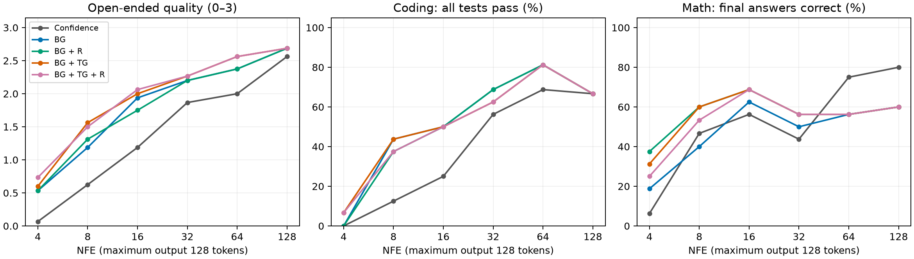
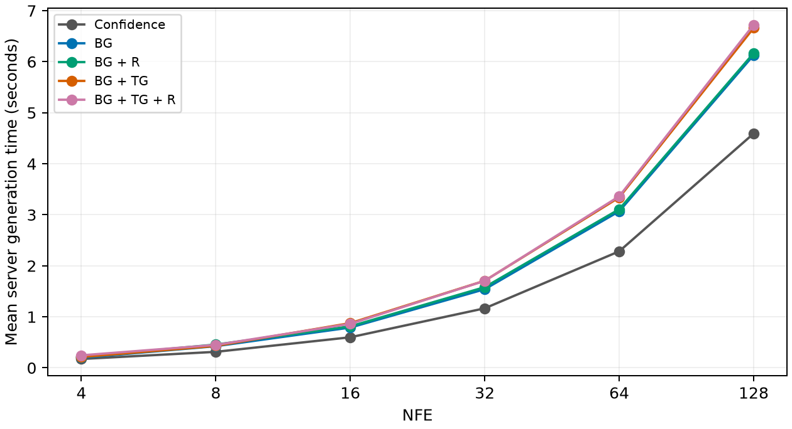

# LLaDA n-gram decoding study — final matched results

Finalized 22 October 2026 after the user requested stopping generation. **1,413 outputs were saved; 1,410 are included.** The three excluded outputs belong to one incomplete five-method comparison. Every included output has been graded. **Sequence sampling was not run.** The originally planned 1,800-run main study and 720-run sampling follow-up were deliberately stopped, not completed.

## Findings

- **Open-ended answers:** BG + TG + R has the highest pooled quality (1.98/3), closely followed by BG + TG (1.96). Both improve over confidence (1.39). The extra repetition penalty does not provide a consistent improvement over trigrams alone.
- **Coding:** BG and BG + TG each solve 49/94 cases (52.1%), versus 36/94 (38.3%) for confidence. Adding the fading penalty reduces either guided variant to 48/94. Trigrams offer no pooled coding advantage over bigrams in this sample.
- **Math:** BG + R is highest pooled at 53/94 (56.4%), followed by BG + TG at 52/94 (55.3%). However, **confidence has higher observed accuracy at NFE 64 and 128**. Guidance helps more at low budgets; some high-budget guided solutions remain fluent despite incorrect arithmetic.
- **Practical choice:** try BG + TG without repetition as a general open-ended option; BG without repetition is the cheaper coding option. For math, BG + R is promising at 4–32 NFE, while confidence is preferable in these 64–128 NFE results. These are exploratory choices among tested packages, not established optimal settings.

## Scope and fair comparison

There are 20 distinct prompts per domain (60 total), with one fixed seed. Interruption leaves **94 prompt/NFE cases per domain**, or 282 cases per method. Each retained case contains all five methods at the same prompt, NFE and requested settings. A case is a prompt/NFE pair, not a new independent prompt. No missing result is imputed. The original manifest, raw outputs and reviews are preserved.

| NFE | Open-ended cases/method | Coding cases/method | Math cases/method |
| --- | --- | --- | --- |
| 4 | 15 | 15 | 16 |
| 8 | 16 | 16 | 15 |
| 16 | 16 | 16 | 16 |
| 32 | 15 | 16 | 16 |
| 64 | 16 | 16 | 16 |
| 128 | 16 | 15 | 15 |

The incomplete comparison is exercise prompt `open_15`, NFE 4: only BG, BG + R, and BG + TG finished. All three are excluded. Their text remains in the raw archive.

Methods: **Confidence** = independent confidence-guided diffusion; **BG** = expanded PMI bigram Viterbi; **TG** = additional trigram guidance; **R** = probability-weighted repetition penalty with the existing fade. All n-gram methods use the same expanded corpus.

## Overall metrics

| Method | Open quality /3 | Open fluency /3 | Coding solved | Math final correct | Math correct + valid working |
| --- | --- | --- | --- | --- | --- |
| Confidence | 1.394 | 1.457 | 36/94 (38.3%) | 48/94 (51.1%) | 30/94 |
| BG | 1.830 | 1.989 | 49/94 (52.1%) | 45/94 (47.9%) | 28/94 |
| BG + R | 1.819 | 1.968 | 48/94 (51.1%) | 53/94 (56.4%) | 30/94 |
| BG + TG | 1.957 | 2.149 | 49/94 (52.1%) | 52/94 (55.3%) | 32/94 |
| BG + TG + R | 1.979 | 2.170 | 48/94 (51.1%) | 50/94 (53.2%) | 31/94 |

Open quality measures coherence, relevance, grammar, repetition and material factual errors. Fluency is scored separately, so fluent factual mistakes do not count as fully correct answers. Math final-answer accuracy requires all requested answers, with correct labels; valid working is stricter and also rejects corrupted equations, contradictions and missing requested reasoning.

## Results by NFE

### Open-ended quality /3

| NFE | Confidence | BG | BG + R | BG + TG | BG + TG + R |
| --- | --- | --- | --- | --- | --- |
| 4 | 0.07 | 0.53 | 0.53 | 0.60 | 0.73 |
| 8 | 0.62 | 1.19 | 1.31 | 1.56 | 1.50 |
| 16 | 1.19 | 1.94 | 1.75 | 2.00 | 2.06 |
| 32 | 1.87 | 2.20 | 2.20 | 2.27 | 2.27 |
| 64 | 2.00 | 2.38 | 2.38 | 2.56 | 2.56 |
| 128 | 2.56 | 2.69 | 2.69 | 2.69 | 2.69 |

### Coding: all tests pass

| NFE | Confidence | BG | BG + R | BG + TG | BG + TG + R |
| --- | --- | --- | --- | --- | --- |
| 4 | 0/15 (0.0%) | 0/15 (0.0%) | 0/15 (0.0%) | 1/15 (6.7%) | 1/15 (6.7%) |
| 8 | 2/16 (12.5%) | 7/16 (43.8%) | 6/16 (37.5%) | 7/16 (43.8%) | 6/16 (37.5%) |
| 16 | 4/16 (25.0%) | 8/16 (50.0%) | 8/16 (50.0%) | 8/16 (50.0%) | 8/16 (50.0%) |
| 32 | 9/16 (56.2%) | 11/16 (68.8%) | 11/16 (68.8%) | 10/16 (62.5%) | 10/16 (62.5%) |
| 64 | 11/16 (68.8%) | 13/16 (81.2%) | 13/16 (81.2%) | 13/16 (81.2%) | 13/16 (81.2%) |
| 128 | 10/15 (66.7%) | 10/15 (66.7%) | 10/15 (66.7%) | 10/15 (66.7%) | 10/15 (66.7%) |

### Math: final-answer accuracy

| NFE | Confidence | BG | BG + R | BG + TG | BG + TG + R |
| --- | --- | --- | --- | --- | --- |
| 4 | 1/16 (6.2%) | 3/16 (18.8%) | 6/16 (37.5%) | 5/16 (31.2%) | 4/16 (25.0%) |
| 8 | 7/15 (46.7%) | 6/15 (40.0%) | 9/15 (60.0%) | 9/15 (60.0%) | 8/15 (53.3%) |
| 16 | 9/16 (56.2%) | 10/16 (62.5%) | 11/16 (68.8%) | 11/16 (68.8%) | 11/16 (68.8%) |
| 32 | 7/16 (43.8%) | 8/16 (50.0%) | 9/16 (56.2%) | 9/16 (56.2%) | 9/16 (56.2%) |
| 64 | 12/16 (75.0%) | 9/16 (56.2%) | 9/16 (56.2%) | 9/16 (56.2%) | 9/16 (56.2%) |
| 128 | 12/15 (80.0%) | 9/15 (60.0%) | 9/15 (60.0%) | 9/15 (60.0%) | 9/15 (60.0%) |

At four steps, open-ended text remains mostly unusable even with guidance, and coding success is at most 1/15. The gains do not make this regime reliable. At 8–16 steps, guidance produces the clearest coding gains. At 128 steps coding ties across methods. Open quality converges, while guided math remains worse than confidence.

### What the repetition penalty and trigrams add

| Change | Open quality change [95% CI] | Coding change [95% CI] | Math change [95% CI] |
| --- | --- | --- | --- |
| BG + TG vs BG | +0.13 grade [-0.02, +0.27] | +0.00 pp [-4.26, +4.30] | +7.45 pp [+1.05, +15.62] |
| BG + R vs BG | -0.01 grade [-0.09, +0.05] | -1.06 pp [-3.23, +0.00] | +8.51 pp [+2.13, +16.50] |
| BG + TG + R vs BG + TG | +0.02 grade [-0.05, +0.09] | -1.06 pp [-3.23, +0.00] | -2.13 pp [-6.52, +0.00] |

The penalty helps low-budget bigram math, especially at four steps (6/16 versus 3/16). It does not improve coding here and does not consistently improve trigrams. The fade is absolute: approximately 1, 0.932, 0.697, 0.303, 0.068, 0; zero from step six onward. Consequently high-NFE differences reflect trajectories changed early, not a penalty active throughout decoding.

## Uncertainty

| Method vs confidence | Open quality change [95% CI] | Coding change [95% CI] | Math change [95% CI] |
| --- | --- | --- | --- |
| BG | +0.44 grade [+0.23, +0.65] | +13.83 pp [+4.30, +23.71] | -3.19 pp [-18.95, +11.70] |
| BG + R | +0.43 grade [+0.23, +0.61] | +12.77 pp [+3.19, +22.83] | +5.32 pp [-7.45, +18.09] |
| BG + TG | +0.56 grade [+0.35, +0.76] | +13.83 pp [+6.25, +21.88] | +4.26 pp [-12.37, +19.78] |
| BG + TG + R | +0.59 grade [+0.41, +0.75] | +12.77 pp [+5.21, +20.88] | +2.13 pp [-13.68, +16.30] |

Intervals use 4,000 paired bootstrap replicates, resampling prompts within each domain and retaining each sampled prompt’s entire available NFE vector. Ratios of total differences to total cases preserve the reported case-weighted means despite incomplete budget coverage. These are exploratory, unadjusted intervals across many comparisons. They capture prompt variation in this small set, not seed variation or reviewer uncertainty. A confidence interval spanning zero does not establish an advantage.

## Speed and decoding changes

| NFE | Confidence (ms) | BG (ms) | BG + R (ms) | BG + TG (ms) | BG + TG + R (ms) |
| --- | --- | --- | --- | --- | --- |
| 4 | 173 | 197 | 216 | 212 | 245 |
| 8 | 314 | 425 | 456 | 430 | 449 |
| 16 | 599 | 790 | 813 | 876 | 862 |
| 32 | 1167 | 1541 | 1581 | 1707 | 1705 |
| 64 | 2283 | 3069 | 3108 | 3340 | 3362 |
| 128 | 4593 | 6130 | 6168 | 6662 | 6723 |

| Method | Pooled mean server ms | Overhead vs confidence | Selector ms/run | Changed editable predictions |
| --- | --- | --- | --- | --- |
| Confidence | 1515 | +0.0% | — | — |
| BG | 2016 | +33.1% | 449.6 | 45.9% |
| BG + R | 2048 | +35.2% | 476.6 | 46.5% |
| BG + TG | 2195 | +44.9% | 618.2 | 50.7% |
| BG + TG + R | 2215 | +46.2% | 641.2 | 51.0% |

Latency is the measured server generation time, excluding client queue/network overhead; three warm-up requests are excluded. These are single executions on shared Hugging Face infrastructure, not repeated microbenchmarks. Selector time is an instrumented portion of the same request. The change fraction compares selected predictions against independent diffusion argmax at editable positions **over all denoising iterations**; it is not final output disagreement between separately generated answers. Counts aggregate positions before taking the ratio. All retained runs used exactly the requested NFE; no added model forwards, APD or early stopping.

## Settings and reproducibility

- Model: `GSAI-ML/LLaDA-8B-Instruct`; Space: `Ruurd/llada-8b-instruct`.
- Space revision: `b31a17ae5d4b017ffad71798ea5f35949416e4d2`.
- Output length/block length 128; NFE 4, 8, 16, 32, 64, 128; seed 42.
- Top-k/candidates 16; temperature 0.7; bigram weight 1; repetition strength 1.
- PMI minimum count 1, clip ±2; trigram minimum count 2, clip ±2, relative weight 0.5.
- Open-ended: Delay EOS/EOT ON, ending-delay strength 10. Coding/math: delay OFF, strength 1 (neutral).
- APD OFF; sequence sampling OFF; count-every-candidate OFF; risk alternative OFF.
- Fading enabled in the repetition methods; diffusion-probability remasking retained.

The current MAP Viterbi path is deterministic and ignores temperature while sequence sampling is OFF; the independent confidence baseline samples with temperature 0.7. This compares the existing method packages. Temperature was not tuned, and the unperformed sequence-sampling follow-up cannot be inferred from these results.

The frozen dataset includes 20 open questions from the standard question list, 20 small Python assignments and 20 arithmetic/algebra/word problems. Correct reference code passes all 199 independent edge tests and fits the same 128-token cap. Coding counts as solved only if all tests and explicit constraints pass. There are no pending code-safety review blocks. Open/math judgments were made by the assistant through explicit inspection of anonymous text, with method/NFE labels hidden; exact duplicates within a prompt share one judgment. This is not independent human or multi-rater evaluation. Some repetition-heavy review displays used exact consecutive substring compression with explicit repeat counts; stored outputs were not altered.

## Limits and interpretation

- Twenty prompts per domain and one seed do not establish a global optimum. The NFE curve also uses slightly different available prompt subsets at different budgets; compare methods within a row, and treat cross-budget differences cautiously.
- The decision to stop was made after inspecting intermediate results; confidence intervals are descriptive and do not correct for this optional stopping or multiple comparisons.
- Open-ended guided methods additionally apply the ending-logit penalty of ten, while confidence uses retention delay. Open gains therefore concern the full package, not isolated PMI effects. Coding/math disable both ending controls.
- The 128-token cap can truncate a valid solution before its final answer, which counts as unsolved. Results do not generalize to long programs or difficult math.
- The development/validation split remains in the archive, but no method was selected and no follow-up was run. All pooled results here are exploratory; there is no claim of held-out confirmation for the practical recommendations.

## Outputs and audit files

- [Best, middle and worst examples for every method, NFE and domain](EXAMPLES.md).
- [Every retained output, prompt and judgment](ALL_OUTPUTS.md).
- [Matched scores CSV](matched_scores.csv), [summary and bootstrap comparisons](matched_summary.json).
- [Frozen run manifest](manifest.json), [original protocol](PROTOCOL.md), [stop snapshot](stop_snapshot.json).
- [Raw main outputs, including the three excluded rows](main/results.jsonl), [retained raw outputs](matched_results.jsonl).
- [Manual reviews](reviews.json), [code checks](code_checks.json), [reference validation](reference_validation.json).

The original protocol describes the larger planned study. This report and the stop snapshot document the user-authorized change in scope. No Space settings, model weights or production code were changed while finalizing this analysis.
