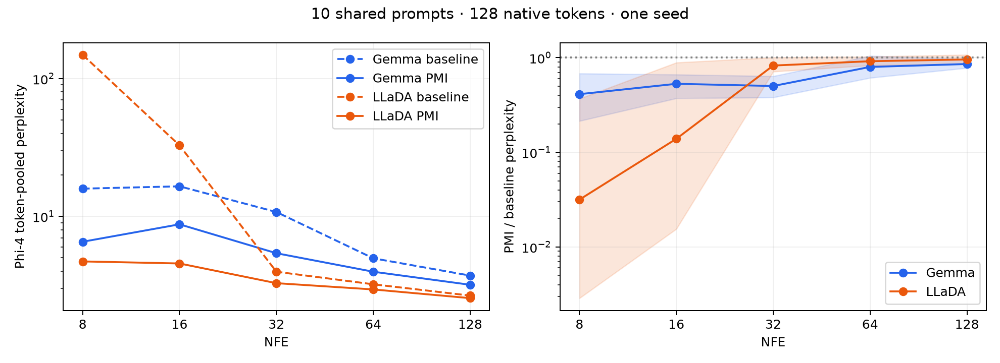

# PMI Viterbi across Gemma and LLaDA

Both models completed the same 10 prompts, 128-native-token limit, one block, seed 1234, and NFE budgets 8, 16, 32, 64, 128: 100 outputs per model. Phi-4 NF4/BF16 scores standalone answers identically for both models.

Confidence-guided baseline: temperature 0.7, top-k 3. PMI Viterbi: temperature 2, top-k/candidates 16, weight 0.5, minimum count 1, clipping ±2, diffusion confidence. EOS/EOT retention delay is on for both; ending prediction delay is 10 for PMI and disabled for the baseline. Early stopping is off.

The bigram scorers use the same 980,000 training responses, separately tokenized for each model. The core sampler and Viterbi source are identical. This tests transfer of the Gemma-preferred settings bundle, not optimal LLaDA settings or the isolated effect of Viterbi.

## Phi-4 token-pooled perplexity

Lower is better. Reduction is relative to the confidence baseline within each model.

| NFE | Gemma baseline | Gemma PMI | Reduction | LLaDA baseline | LLaDA PMI | Reduction |
|---:|---:|---:|---:|---:|---:|---:|
| 8 | 15.89 | 6.54 | 59% | 148.85 | 4.71 | 97% |
| 16 | 16.53 | 8.76 | 47% | 32.75 | 4.55 | 86% |
| 32 | 10.76 | 5.40 | 50% | 3.96 | 3.27 | 17% |
| 64 | 4.96 | 3.96 | 20% | 3.21 | 2.95 | 8% |
| 128 | 3.72 | 3.19 | 14% | 2.66 | 2.55 | 4% |

## Consistency across questions

Per-question wins mean lower reference PPL, not a manual quality judgment. Intervals are paired prompt bootstrap 95% intervals for PMI/baseline pooled PPL; values below 1 favor PMI. One generation seed; 10 questions.

| NFE | Gemma wins | Gemma ratio interval | LLaDA wins | LLaDA ratio interval |
|---:|---:|---:|---:|---:|
| 8 | 9/10 | 0.214–0.681 | 8/10 | 0.003–0.369 |
| 16 | 9/10 | 0.373–0.664 | 8/10 | 0.016–0.888 |
| 32 | 9/10 | 0.381–0.638 | 9/10 | 0.713–1.005 |
| 64 | 8/10 | 0.613–1.046 | 7/10 | 0.829–1.027 |
| 128 | 8/10 | 0.780–0.968 | 6/10 | 0.862–1.072 |

## Repetition and length checks

Distinct-1 is unique token types / total tokens in each complete answer, averaged across questions using each model’s native tokenizer. Higher ratios mean less token repetition. Compare method changes within a model; absolute values across tokenizers are not directly equivalent. The shared 128-token cap also permits different word counts.

| NFE | Gemma Distinct-1 baseline → PMI | LLaDA Distinct-1 baseline → PMI | LLaDA mean words baseline → PMI |
|---:|---:|---:|---:|
| 8 | 0.353 → 0.329 | 0.328 → 0.359 | 94.0 → 108.6 |
| 16 | 0.465 → 0.480 | 0.297 → 0.467 | 92.2 → 104.3 |
| 32 | 0.473 → 0.475 | 0.433 → 0.506 | 104.4 → 110.1 |
| 64 | 0.488 → 0.544 | 0.509 → 0.517 | 102.9 → 108.2 |
| 128 | 0.548 → 0.598 | 0.489 → 0.517 | 105.2 → 109.0 |

Mean number of unique token types in each full answer:

| NFE | Gemma baseline → PMI | LLaDA baseline → PMI |
|---:|---:|---:|
| 8 | 14.4 → 23.0 | 19.6 → 45.1 |
| 16 | 20.3 → 31.5 | 28.6 → 58.8 |
| 32 | 27.5 → 35.2 | 54.2 → 63.7 |
| 64 | 35.6 → 42.2 | 61.4 → 65.2 |
| 128 | 40.3 → 40.0 | 59.4 → 65.2 |

Predictable repetition can receive excellent perplexity. Read the examples and repetition/length checks alongside the scores. These are small exploratory comparisons, not factuality or reasoning benchmarks.

## Full reports and representative answers

- [Gemma report](../perplexity_128/REPORT.md)
- [LLaDA report](../perplexity_llada_128/REPORT.md)

## What carries over to LLaDA?

Under these shared app settings, the clearest LLaDA gains occur at 8 and 16 NFE. PMI wins per-answer PPL on 8/10 questions at both budgets. The large pooled reductions (97% and 86%) are amplified by catastrophic baseline failures: median answer PPL changes from 18.56 to 4.43 at 8 NFE and from 6.31 to 4.81 at 16 NFE. This is a broader improvement than a single outlier, but the pooled percentages should not be interpreted as percentages of answer-quality improvement.

At 32, 64, and 128 NFE, LLaDA's pooled PPL reductions are approximately 17%, 8%, and 4%. Their paired bootstrap intervals include a ratio of 1, so this small experiment does not establish a reliable pooled improvement at those budgets. The baseline is already much stronger there.

With the requested Distinct-1 metric, LLaDA improves at all five budgets. At 16 NFE its mean unique-token count rises from 28.6 to 58.8, and mean Distinct-1 rises from 0.297 to 0.467. For Gemma, Distinct-1 declines at 8 NFE, changes little at 16–32, and improves at 64–128. These statements use unigram diversity throughout; previous Distinct-2 interpretations should not be carried over unchanged.

PMI does not remove low-budget repetition or factual errors. LLaDA's 8-NFE search answer still loops on “web pages,” while its fluent 32-NFE Amsterdam answer names Red Square as a local landmark. At 128 NFE the baseline refrigerator answer loops on “cold air,” whereas PMI gives a sustained explanation. See the good, average, and bad examples in each model's report for the range of behavior.

